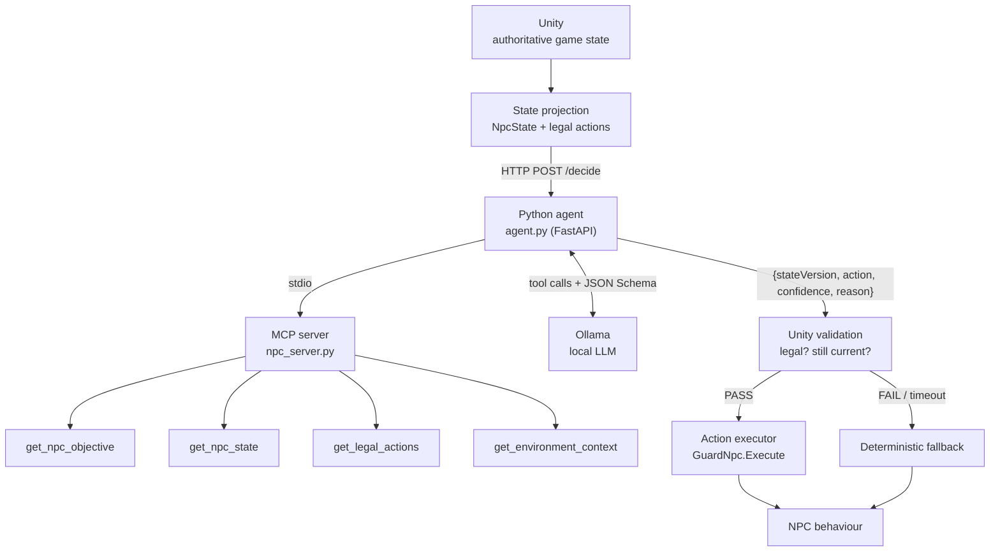

# State-Aware AI NPC with MCP and a Local LLM


A Unity guard NPC whose tactical decisions adapt to the game state. Unity exposes the NPC's situation through
**MCP (Model Context Protocol)** tools, a **local language model served by Ollama** chooses one action from the
actions the game currently allows, and Unity validates and executes that choice with ordinary gameplay code.

The model never controls the game directly: **Unity owns the state, the rules, validation and execution**, the
MCP server gives controlled read-only access to decision-relevant data, and the LLM only contributes tactical
judgement among valid alternatives.

> Course project for **CSE-377 Game Programming** (Mini Quiz: State-Aware AI NPC with MCP and a Local LLM).

---

## Contents

- [Architecture](#architecture)
- [Features](#features)
- [Requirements](#requirements)
- [Quick start](#quick-start)
- [Project structure](#project-structure)
- [How a decision is made](#how-a-decision-is-made)
- [Keeping the AI grounded](#keeping-the-ai-grounded)
- [Results](#results)
- [Testing](#testing)
- [Model choice](#model-choice)

## Architecture



| Component | Responsibility |
|---|---|
| **Unity** | Game state, physics, combat, legal-action generation, validation, execution |
| **MCP server** | Small, read-only tools over the state Unity sent |
| **Agent** | Bounded tool-calling loop, schema-constrained final decision, fact checking |
| **Local LLM** | Picks the most appropriate legal action and explains why |

## Features

- **State-aware decisions:** the same pipeline produces different actions as health, ammo, enemies, allies and cover change.
- **Legal actions only:** Unity generates the allowed set (`ATTACK`, `TAKE_COVER`, `RETREAT`, `CALL_FOR_HELP`, `RELOAD`, `HOLD_POSITION`); the model cannot invent new ones.
- **Structured output:** `{action, confidence, reason}` constrained by a JSON Schema whose `action` enum is the current legal set.
- **Validation and stale-state protection:** every answer is re-checked against the *current* state and `stateVersion` before execution.
- **Never blocks the game:** asynchronous requests, 5 s timeout, deterministic fallback; the game stays playable with the AI offline.
- **Event-driven timing:** decisions on significant state changes or every 3 s, never every frame.
- **Full decision log:** time, NPC, state, legal actions, MCP tools called, decision, confidence, reason, latency, validation result, executed action.
- **NPC personalities (optional §16):** Guard, Scout and Assault share state and actions, but receive different goals.
- **Cooperation (optional §17):** `CALL_FOR_HELP` brings allies to the guard.
- Built entirely from **Unity primitives**; no external assets.

## Requirements

| | Version |
|---|---|
| Unity | 6 (developed on 6000.6.0f1) |
| Python | 3.12 or newer |
| Ollama | any recent version, with a tool-capable model |
| GPU | 4 GB VRAM is enough for the default model |

## Quick start

**1. Install the model and the Python dependencies**

```bash
ollama pull bonsai-2:9b
pip install -r ai/requirements.txt
```

**2. Test the AI without Unity** (Scenarios A-E from the brief)

```bash
cd ai
python agent.py test                         # all scenarios, Guard
python agent.py test B                       # one scenario
python agent.py test A E Guard Scout Assault # compare personalities
```

**3. Start the agent for Unity** (listens on `127.0.0.1:8000`)

```bash
cd ai
python agent.py
```

**4. Play**

Open `UnityProject` in Unity 6, open `Assets/Scenes/NpcScene` and press **Play**.

- The buttons at the bottom load **Scenarios A-E**; the **Role** button switches Guard / Scout / Assault.
- The HUD shows the guard's state, current action and the last AI decision.
- Every decision is appended to `UnityProject/decisions.log`.

If the agent or Ollama is not running, the guard keeps playing on its deterministic fallback.

> The scene can be rebuilt at any time from the menu **CSE377 > Build Scene**.

## Project structure

```
.
├── ai/
│   ├── agent.py              # HTTP endpoint, tool-calling loop, schema-constrained decision, fact check
│   ├── npc_server.py         # MCP server (FastMCP, stdio) with four small read-only tools
│   ├── scenarios.json        # Scenarios A-E for the terminal test
│   └── requirements.txt
└── UnityProject/
    └── Assets/
        ├── Scripts/
        │   ├── NpcState.cs              # state projection, request/response DTOs
        │   ├── LegalActionGenerator.cs  # deterministic legal-action rules
        │   ├── GuardNpc.cs              # authoritative state, combat, action executor, roles
        │   ├── NpcBrain.cs              # timing, request, validation, stale check, fallback, logging, HUD
        │   ├── Enemy.cs                 # enemies (and the player) that shoot the guard
        │   └── ScenarioLoader.cs        # Scenario A-E and role buttons
        ├── Editor/
        │   ├── SceneBuilder.cs          # builds NpcScene from primitives
        │   └── PlayModeSmokeTest.cs     # automated end-to-end test in Play mode
        └── Scenes/NpcScene.unity
```

| Brief requirement | Where |
|---|---|
| Scene from primitives (§2) | `SceneBuilder.cs` |
| NPC state (§3) | `NpcState.cs`, `GuardNpc.GetState` |
| Legal actions and generator (§4-5) | `LegalActionGenerator.cs` |
| MCP server (§6) | `ai/npc_server.py` |
| Local AI agent (§7) | `ai/agent.py` |
| Structured output (§8) | JSON Schema in `agent.py`, `Decision` in `NpcState.cs` |
| Validation in Unity (§9) | `NpcBrain.Validate` |
| Action executor (§10) | `GuardNpc.Execute` |
| State-aware scenarios (§11) | `ScenarioLoader.cs`, `ai/scenarios.json` |
| Not every frame (§12) | `NpcBrain.Update` |
| Latency, timeout, fallback (§13) | `NpcBrain.RequestDecision`, `NpcBrain.Fallback` |
| Stale decisions (§14) | `stateVersion` in `GuardNpc` / `NpcBrain` |
| Logging (§15) | `NpcBrain.Log` -> `decisions.log` |
| Personalities (§16), cooperation (§17) | `GuardNpc.Roles`, `get_npc_objective`, `GuardNpc.CallAllies` |

## How a decision is made

1. **Trigger:** a significant state change (health band, empty ammo, enemy/ally count, cover), a finished action, or the 3 s timer.
2. **Request:** Unity sends `stateVersion`, the state projection, the legal actions, environment context and the NPC's objective.
3. **Tool phase:** the model inspects the MCP tools and calls the ones it needs (bounded to 4 rounds).
4. **Decision phase:** the model answers in JSON; `action` is restricted to the legal actions by the schema.
5. **Fact check:** the agent compares the reason with the tool data and asks for one correction if they disagree.
6. **Validation:** Unity checks that the action is still legal and the state version still matches.
7. **Execution:** Unity's own code moves, shoots, reloads or calls allies.

Example log entry:

```
[15:14:01] NPC: guard_01  Role: Guard  stateVersion: 4
  State: {"health":89.0,"ammo":10,"maxAmmo":10,"enemyDistance":5.0,"enemyCount":1,"nearbyAllies":1,...}
  Legal actions: ATTACK, TAKE_COVER, RETREAT, CALL_FOR_HELP, HOLD_POSITION
  MCP tools called: get_npc_objective, get_npc_state, get_legal_actions, get_environment_context
  Decision: ATTACK  Confidence: 0.85  Reason: High health (89/100) and full ammo (10/10) allow for a direct
            engagement against the single enemy at 5m range.
  Latency: 4435 ms  Validation: PASS  Executed: ATTACK
```

## Keeping the AI grounded

| Layer | What it guarantees |
|---|---|
| Legal-action generator (Unity) | Only rule-allowed actions are offered (no `ATTACK` without ammo, no `TAKE_COVER` without cover, no `CALL_FOR_HELP` when every ally is already coming) |
| Grounding (agent) | No decision without objective, state, legal actions and environment; skipped tools are called by the agent itself |
| Fact sheet (agent) | Tool results are restated as plain facts (health/ammo level, force balance, weapon ranges) without advice |
| JSON Schema (Ollama) | `action` is an enum of the current legal actions, so an invented action cannot be generated |
| Fact check (agent) | A reason that contradicts the data ("low ammo" at 10/10, "outnumbered" at 1 vs 2, wrong side of a range) gets one correction round; if it is still wrong, the decision is rejected |
| Validation (Unity) | Action must still be legal and `stateVersion` must still match |
| Fallback (Unity) | Timeout, error or rejection -> `TAKE_COVER` if cover exists, otherwise `RETREAT` |

The tactical choice itself is left to the model: the system prompt lists tactical *considerations*, not if/else rules.

## Results

Terminal test with `bonsai-2:9b` (~2.7-4.5 s per decision):

| Role | A: Strong | B: Critical health | C: No ammo | D: Outnumbered | E: Supported |
|---|---|---|---|---|---|
| Guard | ATTACK | TAKE_COVER | RELOAD | CALL_FOR_HELP | ATTACK |
| Scout | TAKE_COVER | TAKE_COVER | TAKE_COVER | RETREAT | ATTACK |
| Assault | ATTACK | TAKE_COVER | RELOAD | RETREAT | ATTACK |

- The Guard matches the brief's reasonable examples in all of A-D.
- In C, `ATTACK` is never offered because the guard has no ammo.
- Same state, different role, different decision (A, C).

## Testing

**Terminal:** `python agent.py test` also runs built-in assertions for the fact checker.

**Play mode, end to end:** with the agent running and Unity closed:

```bash
Unity.exe -batchmode -projectPath UnityProject -executeMethod PlayModeSmokeTest.Run -logFile smoke.log
```

It plays every scenario with every role in real Play mode, then once with the agent unreachable, and writes
`UnityProject/smoke_test.txt` (exit code 0 = all checks passed). Last run: 0 errors, every decision made for the
current state passed validation, stale or failed answers were ignored or replaced by the fallback, and the game
kept running with the agent offline.

## Model choice

Tested on an RTX 3050 Ti laptop GPU (4 GB VRAM). Each model ran Scenarios A-D three times; a pick counts when it
is one of the brief's reasonable examples.

| Model | Score | Time per decision | Note |
|---|---|---|---|
| llama3.1:8b (brief's baseline) | - | ~40 s | only 13/33 layers fit on the GPU |
| qwen2.5:3b | 6/12 | ~3 s | never chose RETREAT/CALL_FOR_HELP in D |
| llama3.2:3b, qwen3:4b, bonsai-2:4b | <= 6/12 | 3-13 s | looped on or skipped tool calls, or always TAKE_COVER |
| **bonsai-2:9b** | **12/12** | **~3 s** | ternary weights, 2.8 GB, all layers on the GPU |

With 8 GB of VRAM or more the brief's baseline works as well:

```bash
NPC_MODEL=llama3.1:8b python agent.py
```

---

**Author:** Tahircan Saçlı
